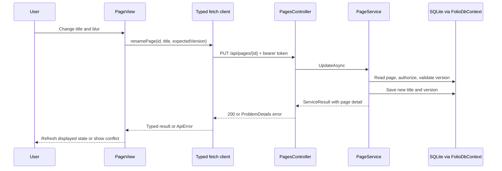

# Follow a page rename through the code

Read one behavior all the way through before reading entire directories. A useful code map answers: where does the input start, where is it checked, where does truth change, and how does the result reach the user?

## Read in this order

1. [App.tsx](../../folio-app/client/src/App.tsx): which route renders a workspace, and where authentication wraps it?
2. [WorkspacePage.tsx](../../folio-app/client/src/pages/WorkspacePage.tsx): how are the selected page and refresh callbacks connected?
3. [PageView.tsx](../../folio-app/client/src/components/PageView.tsx): find the title input, blur handler, `renamePage`, and conflict branch.
4. [folio.ts](../../folio-app/client/src/api/folio.ts): find the route and HTTP method in `renamePage`.
5. [client.ts](../../folio-app/client/src/api/client.ts): inspect headers, serialization, 204 handling, and `ApiError`.
6. [PageDtos.cs](../../folio-app/server/Folio.Api/Contracts/PageDtos.cs): read `UpdatePageRequest`, its validation attributes, and `ExpectedVersion`.
7. [PagesController.cs](../../folio-app/server/Folio.Api/Controllers/PagesController.cs): find `Update`, then how `MapToDetail` maps service statuses.
8. [PageService.cs](../../folio-app/server/Folio.Api/Services/PageService.cs): read `UpdateAsync`, its authorization call, version comparison, mutation, and persistence.
9. [PageAuthorization.cs](../../folio-app/server/Folio.Api/Auth/PageAuthorization.cs), [Page.cs](../../folio-app/server/Folio.Domain/Entities/Page.cs), and [FolioDbContext.cs](../../folio-app/server/Folio.Infrastructure/Persistence/FolioDbContext.cs): identify caller access, stored state, and database mapping.
10. [PageView.test.tsx](../../folio-app/client/src/components/PageView.test.tsx) and [ProductionReadinessTests.cs](../../folio-app/server/Folio.Tests/ProductionReadinessTests.cs): locate evidence for the successful and stale-write paths.

## Translate the vocabulary

A component renders UI. A typed client centralizes the wire protocol. A DTO describes data crossing an API boundary. A controller translates HTTP to a service call. A service coordinates business behavior. An entity describes persisted business state. A DbContext tracks queries and changes for EF Core. A migration is an ordered database schema change.

These roles are not one universal folder structure. Folio App keeps services in `Folio.Api` and calls its DbContext directly. Atlas has a separate Application layer with ports. Learn the actual dependency graph before suggesting a restructuring.

## Trace with a debugger

Run the API under your editor's .NET debugger or attach to the process you started. Set a breakpoint in `PageService.UpdateAsync`. Rename a page in the browser. Inspect the request's title, caller workspace, stored version, and expected version. Step to `SaveChangesAsync`, then inspect the response in Network. If the breakpoint never hits, verify which process owns port 5080 and which URL the client called.

Do not step into every framework method. Use step-over for ordinary calls, step-into for the behavior you are investigating, and the call stack to orient yourself. Remove temporary logging and breakpoints that would disclose tokens or interfere with normal use.

## Predict three failures

Before trying them, write the expected path for a blank title, a Viewer rename, and a stale `expectedVersion`. For each, name the earliest responsible layer and the expected HTTP status. Then verify through the API or existing tests. A disabled button demonstrates UX; it does not establish server authorization.

The version check is optional when the caller omits `ExpectedVersion`. Inspect the implementation before claiming it prevents every possible concurrent write: a stale request rejected after another request completes is different from two overlapping database updates. This distinction returns in Module 08.

Finish by drawing this flow from memory with real filenames and a failure branch. See [Module 02](../modules/02-language-and-navigation.md) for exercises that build the language skills behind the trace.
